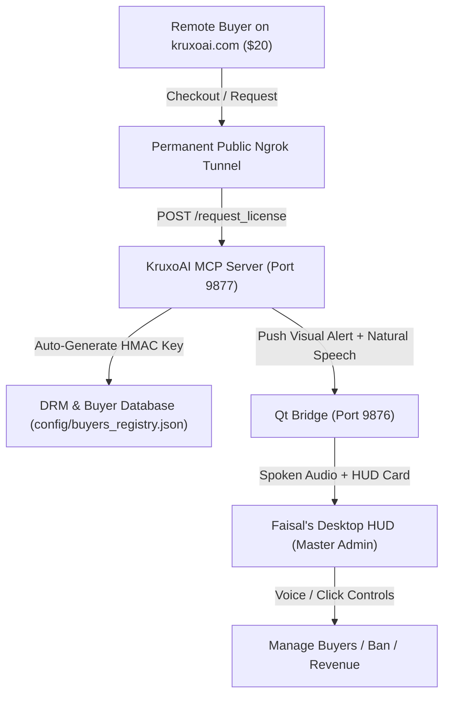

# 🚀 KruxoAI v2.0 Commercial Upgrade Documentation & Release Notes

**Product:** KruxoAI — Autonomous Sci-Fi Desktop AI System  
**Official Store & Website:** https://kruxoai.com  
**Founder & Developer:** Faisal (mrsmithcons-tech)  
**Official Support:** kruxoai@gmail.com  
**License Model:** $20 USD Lifetime Access (One-time purchase, zero recurring fees)  
**Repository:** https://github.com/mrsmithcons-tech/kruxoai  

---

## 🌟 Executive Summary: From Simple Assistant to KruxoAI

The project has undergone a complete architectural, visual, and commercial transformation. Originally conceived as a simple voice script with generic movie/Iron Man elements, it is now **KruxoAI**: an independent, production-grade, commercial Sci-Fi AI desktop companion owned by **Kruxoai.com**, backed by cryptographic licensing, tamper-proof DRM, and an automated Master Admin control center.

---

## 1. 🎨 Complete Brand Transformation & Modern Sci-Fi UI

- **100% Brand Ownership:** Removed all legacy "JARVIS", "Mark LVII", and generic movie references from user-facing screens, window titles, subtitles, headers, and tooltips.
- **Unified Branding:**
  - **Window Title:** `KRUXOAI — kruxoai.com — Built by Kruxoai.com`
  - **Top Banner Subtitle:** `kruxoai.com · BUILT BY KRUXOAI.COM · AUTONOMOUS SCI-FI AI`
  - **Sub-label Tooltip:** `KRUXOAI — Autonomous Sci-Fi AI Desktop System — Built by kruxoai.com`
- **Cinematic Dual-Tone Persona:** KruxoAI speaks with futuristic confidence in English, and natural warmth and respect in Roman Urdu (*"Hukum kijiye Faisal, system bilkul smooth chal raha hai"*).
- **Holographic 3D Wireframe Avatar:** Procedural facial mesh with real-time lip-sync, blinking, idle gaze, and emotion reactivity.
- **Hardware Telemetry HUD:** Real-time gauges for CPU load, Memory consumption, GPU activity, Audio Spectrogram, and system diagnostics.

---

## 2. 🛡️ Commercial Licensing Engine & Strict DRM Protection

KruxoAI is built to prevent unauthorized use, illegal redistribution, or tampering:

1. **Mandatory Startup Activation Gate (`gui/overlays.py`):**
   - Fresh downloads without a verified `config/license.json` cannot access the assistant.
   - The UI displays a futuristic holographic **License Activation Overlay**.
   - Speech listening, mic input, and tools are strictly locked until a valid key is activated.
2. **Cryptographic Mathematical Verification (`core/license_manager.py`):**
   - Keys follow the format `KRUXO-XXXX-XXXX-XXXX-XXXX`.
   - Each key is signed with an internal HMAC-SHA256 signature combining the buyer's email and a secret seed.
   - Keys are validated mathematically and verified against an active/banned status list.
3. **Anti-Tamper & Code Integrity Sentinel:**
   - Critical system files (`core/license_manager.py`, `gui/window.py`, `core/jarvis_mcp_http.py`) are continuously fingerprinted with SHA-256 hashes.
   - If a cracked copy attempts to bypass the license check, the engine triggers an automatic license revocation and blacklists the instance.
4. **Zero-Secret Public Repo:**
   - Private API keys, customer databases (`config/buyers_registry.json`), and individual license files are strictly ignored via `.gitignore`.
   - Public downloaders receive `config/api_keys.example.json` and must input their own keys after purchasing a license.

---

## 3. 👑 Master Admin Command Center (Faisal's Local Installation)

Faisal's desktop copy functions as the **Central Commercial Hub**:

| Access Method | Feature | Action / Result |
|---|---|---|
| **HUD Button** | `👥 BUYERS & DRM MANAGER` in Setup Drawer | Displays total sales revenue ($20 * active buyers), active vs. banned counts, full buyer records table, and incoming requests. |
| **Voice Command** | *"Show buyers"* or *"Sales kitni hui hai?"* | KruxoAI reads the registry, calculates total revenue in USD, and renders an executive card on the HUD. |
| **Voice Command** | *"Generate license for [email]"* | Generates a signed $20 lifetime license key and records the buyer in seconds. |
| **Voice Command** | *"Ban user [email/key]"* | Blacklists the buyer globally; locks down their KruxoAI instance immediately. |
| **Batch Tools** | `manage_buyers.bat` | Interactive double-click console for complete buyer management. |
| **Batch Tools** | `generate_key.bat` | 2-second key generator prompt. |

---

## 4. 🔔 Automated Remote Request Detection & Voice Alerts

Whenever a buyer purchases or requests activation via **`kruxoai.com`**:
1. Request arrives via the permanent static public tunnel at `/request_license?email=...&name=...`.
2. The MCP HTTP Server auto-generates the lifetime key and records the transaction in `memory/license_requests.json`.
3. **Instant Audio Alert:** KruxoAI speaks aloud through Faisal's speakers:
   > *"Faisal, a new license activation request has arrived from [Buyer Name]. Lifetime key [KRUXO-XXXX] has been generated."*
4. **Visual HUD Card:** A notification card appears on screen with the buyer's details, payment reference, and license key.

---

## 5. 🧩 Multimodal & Autonomous AI Capabilities

KruxoAI is equipped with advanced built-in autonomous tools:

- **User Emotion & Vision Recognition (`plugins/user_emotion_vision_recognition.py`):** Real-time camera feed analysis assessing user mood, expression, fatigue, and posture.
- **Biometric Fusion Security (`plugins/biometric_fusion_security.py`):** Multi-factor facial and voice biometric verification for secure actions.
- **Sleep Sentinel (`actions/sleep_sentinel.py`):** Overnight monitoring of ambient room conditions, noise spikes, and wake-up sleep quality reporting.
- **Autonomous Dev Agent (`actions/dev_agent.py`):** KruxoAI can self-diagnose, build new plugins, upgrade its own codebase, and evolve capabilities autonomously.
- **Google Workspace Sync (`plugins/gmail_calendar_sync.py`):** Instant voice-activated inbox summarization and calendar event creation.

---

## 6. 🌐 Connectivity & Public MCP Tunnel

- **KruxoAI MCP Server (`core/jarvis_mcp_http.py`):** Multi-threaded JSON-RPC 2.0 / Streamable HTTP server on port `9877`.
- **Permanent Static Ngrok Tunnel:** Live at `https://stabilize-gladly-possibly.ngrok-free.dev`.
- **Endpoints:**
  - `GET /health`: Health and server metadata.
  - `GET /tools` & `POST /mcp`: Remote tool execution and agent connectivity.
  - `GET /request_license`: Automated customer key issuance and notification.
  - `GET /license_check`: Remote DRM validity and blacklist checks.

---

## 7. 📦 Commercial Distribution & Legal Framework

- **Commercial EULA (`LICENSE`):** Custom KruxoAI Commercial End User License Agreement granting single-user lifetime access while explicitly prohibiting unauthorized resale, redistribution, decompilation, or sublicensing.
- **GitHub Repository:** Clean, production-ready codebase hosted at https://github.com/mrsmithcons-tech/kruxoai.
- **Release Asset:** KruxoAI v2.0 Commercial Executable package tagged and published on GitHub Releases.
